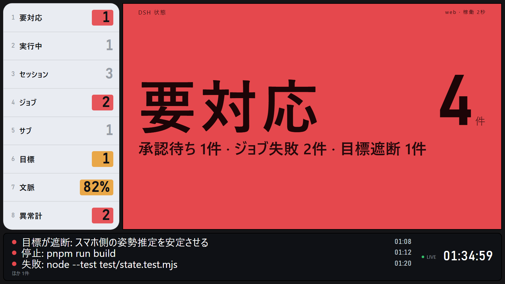
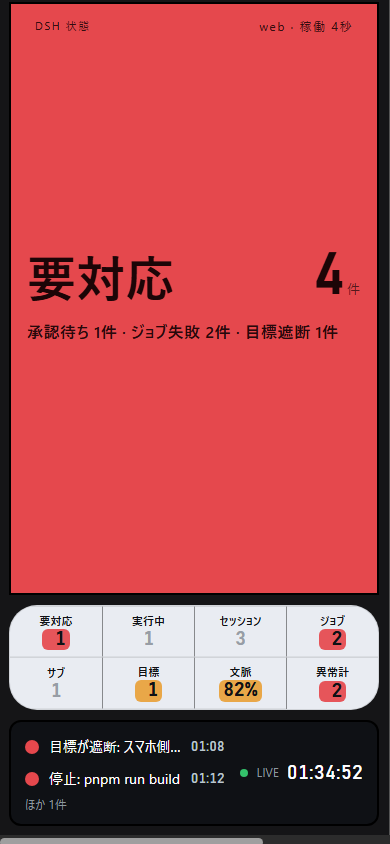

# dsh-andon

DSH (DeepSeek Harness) の稼働状態を、常時点灯させておくアンドン盤にして配るローカルプラグイン。盤はハーネス自身の web サーバーに読み取り専用のルートとして乗るので、既にハーネスへ届いている経路（tailnet・トンネル・LAN）がそのまま盤にも届く。ハーネスのチャット UI には手を入れない。

- **アンドン盤** `/andon/` — 画面全体が1つの色ランプになる工場アンドン。緑が正常、黄が注意、赤が要対応。2〜3m先から読む。**これが本体。**
- **カンバン盤** `/kanban/` — 同じ状態を4列のカードで見せる暗色の盤。**現在は主役ではない。**

読み取り専用。盤にできるのは、見る・カードをクリックして詳細を開く・Esc で閉じる、の3つだけ。

> カンバンについて: 世の中にもっと良いカンバンがあるので、このプロダクトは
> アンドンに絞った。ページと `/kanban/` のルートは残してある（ブックマーク互換）
> が、アンドンからは導線を張っていないし、今後の面倒も見ない。

| デスクトップ | スマホ（390 CSS px） |
|---|---|
|  |  |

要対応の状態。左の8工程のうち**呼んでいるものだけ**が色面のセルになる。全部を塗ると本当の異常が埋もれるので、平常時の工程は数字だけにしてある。下の黒い帯が「何が呼んだか」と時計。

## いまの画面（2026-10-25）

**全面が状態色**の盤に戻した。正常=緑 / 注意=黄 / 要対応・異常=赤 / 通信断=灰。
画面は3つだけ: 全面の色＋巨大な状態語、左の工程レール（8局）、黒いチッカー（何が呼んだか＋時計）。

- セッションの一覧やカードは**出さない**。詳細は DSH 側でセッションを開いて見る方が速い、という判断。
- 判定は v2 の `overall`（サーバ1箇所）。v1 の `status` は承認待ちしか数えないため、
  入力待ちのセッションを取りこぼす（実測で「要対応」を「注意」と誤表示した）。
- 数字は**同じ値を共有**する: 全面の大きな件数・レールの「要対応」・理由の行は
  すべて `counts.needsYou`。食い違うと「どちらが本当か」を読み手に考えさせる。
- 取れない値は `—`。0 で埋めない（0 は「無い」という主張になる）。
- 画面が読むのは**軽い形**（`GET /api/andon/state`・実測 約4.5KB）。v1 キー入りの
  互換形（約12KB）は `?compat=1` のときだけ。

> 以前の v2 画面（暗背景＋カード＋セッション一覧＋履歴帯）は `docs/CONTRACT-v2.md`
> と git 履歴に残っている。状態モデル・WS・通信断検知は今の画面でもそのまま使っている。

## 見た目の層

見た目は2つの層でできていて、CSS の読み込み順がそのまま優先順位になる。

| 順 | ファイル | 担当 |
|---|---|---|
| 1 | `public/tokens.css` | 凍結した素の色・寸法 |
| 2 | 各ページの `<style>` | レイアウトの骨格とブレークポイント |
| 3 | `public/md3ex.css` | M3 Expressive の形・モーション + **末尾に DSH 層** |

DSH 層の色は推測ではなくハーネス本体から写している（`@deepseek-ai/dsh-client-ui-theme/lib/client.js` の `--dsw-static-neutral-bluish-*`）。地 `#151517` / レール `#e9ecf2` / チッカー `#0f1115` / 書体はハーネスと同じ系 / 罫線は黒10% / 角丸12px。**色面（緑・黄・赤）は DSH 層でも触らない。** あれは盤の機能そのもので、装飾として扱うと盤が読めなくなる。

## 動く環境

| 環境 | 状態 |
|---|---|
| PC（最新の Edge / Chrome） | 確認済み（1920×1080） |
| タブレット（iPad・Android・Fire タブ横向き 1280×800） | 確認済み |
| スマホ（390 CSS px） | 確認済み |

**Amazon Fire タブ（Fire OS 5 / Silk）** は Chromium が 80 より前なので、素直に書くと盤は「読み込み中」のまま止まる。そのため次を守っている（守られていることをテストが見張っている）。

- クライアント JS は ES2015 まで。`?.` `??` `async/await` `padStart` `Object.entries` `**` 数値セパレータは**使わない**。構文エラーは「動かない」ではなく「何も起きない」という形で現れるので、テストで禁止した。
- `AbortController` は機能検出してから使う（無い環境ではタイマーとの競争でタイムアウトさせる）。
- `clamp()` が無いので、`@supports not (font-size: clamp(...))` の中に `vw` だけの値を持つ。無いと文字が継承サイズまで縮んで読めない。
- `color-mix()` が無いので、色の宣言の**直前に素の色**を置いた。無いと警報セルの塗りが消え、盤の意味が消える。
- `100dvh` の前に `100vh` を置く。
- flex の `gap` は効かない（Chromium 84+）。ここだけは間隔が詰まるが、読めなくはならないので許容している。

## 2枚の盤

### アンドン `/andon/`

画面は3段。番号付きの工程リスト（8局）、色の面、黒い帯（ティッカー）だ。

並びは見る端末で変わる。PC では工程リストが左、色の面が右。タブレットでは色の面の上に工程リストが横帯になる。スマホでは色の面の下に 4×2 の工程グリッドが来る。390px に8列を詰めるとラベルが読めなくなり、読めないラベルは行が1つ減るより悪い。状態語と件数はどの端末でも横並びのままで、縮む。

色は盤の大部分を占める。状態語は `正常` / `注意` / `要対応` の3つだけで、大きな数字は要対応の件数を出す。2〜3m離れた位置から色と数字だけを拾えるようにしてある。

色の割り当ては設計上の判断としてこう決めた。

| 色 | 状態 | 意味 |
|---|---|---|
| 緑 | 正常 | 人間が何もしなくてよい |
| 黄 | 注意 | 人間が見ておくべき |
| 赤 | 要対応 | 人間が動かないと先へ進まない |

赤と黄は「人間が介在しないと進まない」ものだけに使う。IEC 60073 とトヨタのアンドンの慣行に合わせた。赤を「なんとなく悪いもの」に広げると、本当のアラームが埋もれる。

色は符号の一部でしかない。各局の行には必ず通し番号とラベルが出るので、色が読めなくても、モノクロで印刷しても、隣の局と区別できる。

呼んだ局は左のリストで数値セルが点灯する。行全体は塗らない。8局のうち5局を赤く塗ると全部が同じ緊急度に見え、盤が本当の異常を隠してしまうからだ。呼んだ内容は下のティッカーに `承認待ち: bash` の形で並ぶ。

アンドン盤にアニメーションは無い。色の切り替えにトランジションも掛けない。アンドンは瞬時に変わるもので、ゆっくり色が変わる盤は警報ではない。動きがあるのはカンバン側のランプの呼吸だけで、`prefers-reduced-motion` で止まる。

ハーネスへの接続が切れても数字は消さない。色面が灰に落ち、代わりに `接続できません · 最終更新 12:30:05` が出る。

### カンバン `/kanban/`

腕を伸ばせば届く距離で、DSH が今なにをしているかを追う盤。

- ヘッダ: 接続状態、モデル、トークン、稼働時間、時計、アンドン盤へのリンク
- バイタル帯: エージェント / ジョブ / 目標 / 文脈ゲージ / 作業ディレクトリ
- 4列: 要対応 / 実行中 / 待機 / 完了・直近
- 最下部: アクティビティの流れ

カードは見出し（2行でクランプ）、メタ行、状態チップ、経過時間、指標2〜3個の順に積む。進捗バーは ToDo があるカードにだけ描く。カードをクリックすると右から詳細ドロワーが開き、Esc で閉じる。

列が空のときは列ごとの文言を出す。接続が切れたときは上部に帯を出し、数字は消さずグレーのまま残す。

## インストール

プロファイルのパッチに挿入行を足し、DSH ホストを再起動する。挿入行は起動時に一度だけ合成される。

`~/.dsh/profiles/web/cordis.patch.yml` の末尾に次を足す。

```yaml
- insert:
    - id: andon
      name: 'file:///C:/Users/<you>/Documents/DSH/playgrounds/dsh-andon/lib/index.js'
```

`name` はチェックアウトを直接指す file URL でよい。この形は同梱の `cordis.patch.yml` にもコメントとして書いてある。

パッケージとして入れて `dsh-andon` の名前で解決させる手もある。`dsh plugin` は残りの引数をプロファイルのディレクトリで pnpm に転送するコマンドなので、サブコマンドは `add` を使う（`install` は無い）。

```
node C:\Users\<you>\AppData\Roaming\npm\node_modules\@deepseek-ai\dsh\lib\bin.js plugin --profile web add C:\Users\<you>\Documents\DSH\playgrounds\dsh-andon
```

この場合、同梱の `cordis.patch.yml` が `name: dsh-andon` の挿入行を持っているので、パッチを手で書く必要はない。

起動後の確認は次の1本で足りる。`{"ok":true,...}` が返れば収集が動いている。

```
curl http://127.0.0.1:3080/api/andon/health
```

### タブレット・スマホから見る

いちばん簡単なのは、プラグイン自身の素の HTTP リスナーを使う方法だ。`lan.enabled` を `true` にすると同じ盤を別ポートから配る。ハーネス本体を LAN に晒さずに済むので、こちらを既定にしている。

```yaml
      config:
        lan:
          enabled: true
          host: '0.0.0.0'
          port: 3090
```

これで `http://<LAN-IP>:3090/andon/` が開く。このリスナーが bind に失敗しても本体は動き、警告を1行出して諦める。

`<LAN-IP>` は DHCP で変わる。ブックマークが繋がらなくなったら、まずこれを実行して今のアドレスを確かめる（実例: ある日 `<LAN-IP>` だったものが翌日 `<LAN-IP>` になった）。

```powershell
(Get-NetIPAddress -AddressFamily IPv4 | Where-Object { $_.IPAddress -like '192.168.*' }).IPAddress
```

ファイアウォールで `Node.js JavaScript Runtime` の受信が許可されている必要がある（Private/Public 両方）。

ハーネス本体の 3080 から配りたい場合は、そのリスナー自体を LAN に開ける必要がある。web プロファイルの `webserver` 行は `host: !!js ctx.webStartup.host ?? '127.0.0.1'`、`port: !!js ctx.webStartup.port ?? 3080` で、既定はループバックのみ。`0.0.0.0` に変えると `http://<LAN-IP>:3080/andon/` が開く。`WebServer` の config は `127.0.0.1` と `0.0.0.0` の2値しか受け付けない。ただしこれは GUI ごと LAN に出る操作なので、盤だけ見せたいなら上のリスナーを使う。

## 設定

| キー | 既定 | 意味 |
|---|---|---|
| `exposeOnHarness` | `true` | ハーネスの web サーバーにルートを登録する |
| `basePath` | `/andon` | アンドン盤のマウント先 |
| `lan.enabled` | `false` | ハーネスとは別に素の HTTP リスナーを立てる |
| `lan.host` | `0.0.0.0` | そのリスナーの bind |
| `lan.port` | `3090` | そのリスナーのポート |

`basePath` が動かすのはアンドン盤だけ。カンバン盤は `/kanban`、API は `/api/andon/*` に固定で残る。

`exposeOnHarness` と `lan.enabled` の両方を `false` にすると、盤はどこからも見えなくなる。そのときは警告が1行出る。

ルートはすべて完全一致（`kind: 'exact'`）で登録する。前方一致のルールを1つも持たないので、ハーネスの既存ルートを盤が覆い隠すことも、その逆も起きない。

## 見る・試す

配るルートは次のとおり。

| ルート | 返すもの |
|---|---|
| `/andon` | `/andon/` へ 302 |
| `/andon/` | アンドン盤 |
| `/kanban` | `/kanban/` へ 302 |
| `/kanban/` | カンバン盤 |
| `/andon/assets/<file>` | `tokens.css` `board.js` `andon.js` |
| `/kanban/assets/<file>` | `tokens.css` `board.js` `kanban.js` |
| `/api/andon/state` | 両盤が叩く JSON |
| `/api/andon/health` | 収集が動いているかの生存確認 |

アセットは許可リスト方式で、`public/` の上記のファイル以外は返さない。

### 単体で開く

ハーネスを起動しなくても盤を開ける。プレビューサーバーは本物の collector を mock した `ctx` に当ててスナップショットを作るので、見えているものは本番と同じ経路で組まれたデータだ。

```
node tools/preview.mjs --port 4173
```

`http://127.0.0.1:4173/andon/` と `http://127.0.0.1:4173/kanban/` が開く。

状態を差し替えるには、ページの URL に `?scenario=` を付ける。`busy`（既定）/ `empty` / `alarm` の3つ。シナリオはページ側で覚えるので、`/andon/?scenario=empty` を開けば `empty` の盤が出る。

### テスト

```
node test/state.test.mjs
```

17件。JSON 契約、8局の固定順、承認待ちの復元、アクティビティの上限、カードの列分けを検証する。加えて、サービスが全滅しても落ちないこと、ルート登録、資産の Content-Type まで確認する。`npm test` は `node --test test/` を呼ぶが、閉じたサンドボックスでは spawn の EPERM で落ちることがある。直接叩けば通る。

### スクリーンショット

盤の見た目を撮って確認するときは、ヘッドレス Edge に `--force-device-scale-factor=1` を付ける。付けないと DPI スケーリングで幅720px程度のレイアウトが描かれ、レビューが実物と違う絵を批評することになる。

`node tools/shots.mjs --port 4173` は 3ビューポート × 2盤 × 3シナリオをまとめて撮る。

スマホ幅の確認だけは `tools/phone-harness.html` を使う。ヘッドレス Edge はウィンドウを約500px未満に縮めないので、`--window-size=390` を指定すると「500pxで組んで390pxで切り取った」絵が返る。盤が狭い画面で溢れているように見えるが、CSS は正しい。iframe は本物のビューポートなので、390px の中身を正しく評価できる。

## データ契約

`/api/andon/state` が唯一のデータ源。`schema: 1` で、すべてのキーが常に存在する。配列は `[]`、数値は `0` で、`undefined` は混ざらない。取得できなかった項目は例外ではなく `notes[]` の1行になり、そこに理由が入る。文字列は200文字で切る。

`stations` は必ず8件で、順序は `needs-you` / `running` / `sessions` / `jobs` / `subagents` / `goals` / `context` / `errors` に固定。UI はこの順序を信用してよい。

形・色・寸法の正は [DESIGN.md](DESIGN.md)。この README は使い方の説明であって契約ではない。契約を変えるときは DESIGN.md を先に直す。

## 制限と設計上の割り切り

**質問待ちは数えない。** `dsh-user-questions` は waterfall イベントしか外に出しておらず、これを観測する方法を誤るとハーネスがそもそも質問を出せなくなる。危険を取らない代わりに、`pendingQuestions` は契約上も常に `0` のままにする。人間が止めているという同じ意味を持つ承認待ちは、セッションログから安全に観測できるので `pendingApprovals` として数える。

承認待ちそのものにも列挙 API が無い。生存セッションのログを後ろから畳み、`asked` があって `decided` がまだ来ていないものを拾って復元している。1セッションあたり最後の400イベントしか見ないので、それより古くに聞かれた承認は盤に出ない。承認は6時間で消える。承認のセッションが生存一覧から消えていれば、その承認も落とす。

観測にも上限を置いた。サブエージェントは直近12セッション分、チームのタスクは root agent 8つ分までしか見ない。`alerts` は20件、`cards` は40件、`activity` は40件、`notes` は6行で頭打ちにする。盤を止めないための上限であって、ハーネス側の全量ではない。

失敗・停止したジョブは2時間だけ盤に残り、完了したものは30分で消える。要対応のカウンタも同じ窓を使う。数字と内訳が食い違う盤は、壊れて見えるからだ。

更新は SSE ではなくポーリングにした。両盤とも `GET /api/andon/state` を叩く（アンドン2秒、カンバン3秒）。Cloudflare トンネル経由のバッファリングで壊れる経路があるためだ。タブが隠れている間はポーリングを止め、表に戻ると即座に1回叩く。ホストが落ちている間は2秒→4秒→8秒→15秒と間隔を伸ばす。

依存は `webServer` だけにしてある。観測用のサービス（sessions、agents、jobs、goals、subagents、agentTeams など）は `ctx` から都度引く。1つ欠けたプロファイルでもプラグインは読み込まれ、欠けた項目が `notes` の1行になるだけで済む。

**DESIGN.md と現物の食い違い。** DESIGN.md §6 にあるファイル名 `test/state-test.mjs` と `inject` の一覧は現物と合っていない。実際は `test/state.test.mjs` で、`inject` は `['webServer']` だけ。`package.json` の `shot` スクリプトが指す `tools/shots.mjs` も置かれていない。設計契約のうち色・寸法・JSON 形状は DESIGN.md が正、ファイル構成は現物が正。
